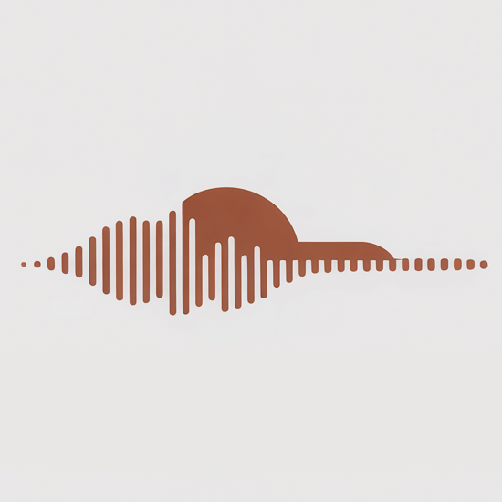
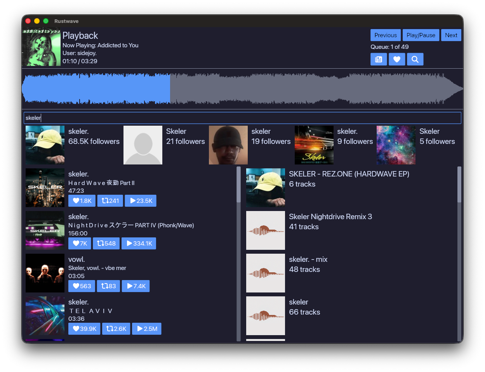
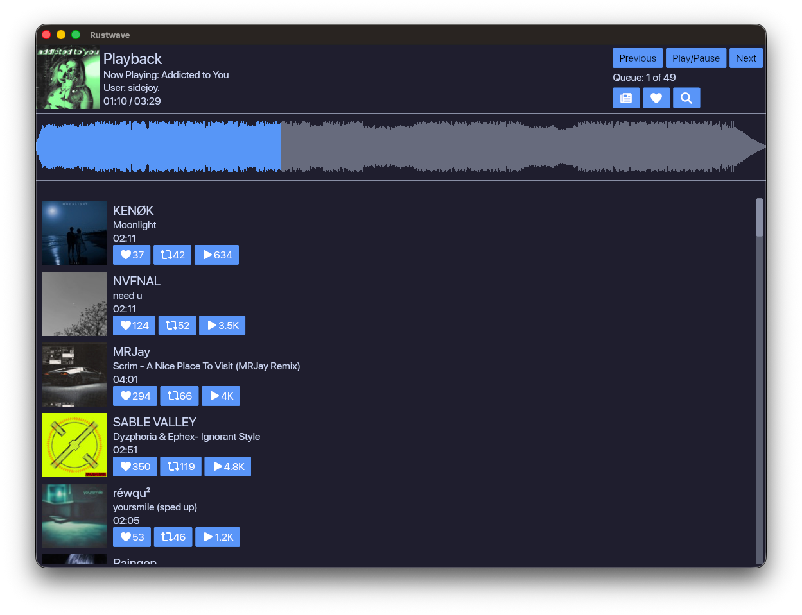

<p align="center">
    
<br>
<a href="https://github.com/IxianPixel/rustwave/releases/latest">
    
</a>
<a href="https://github.com/IxianPixel/rustwave/actions/workflows/ci.yml">
    
</a>
<a href="https://github.com/IxianPixel/rustwave/actions/workflows/release.yml">
    
</a>
</p>

## Table of Contents

- [About](#about)
- [Installation](#installation)
- [Screenshots](#screenshots)
- [Acknowledgement](#acknowledgement)

## About

Rustwave is a SoundCloud client written entirely in Rust. It is still under heavy development with features being added
regularly. The goal is to reach feature parity with the official SoundCloud. The current feature set includes:

- Loading Feed
- Loading Likes
- Searching
    - Tracks
    - Users
    - Playlists
- Liking Tracks
- Playing Tracks
- Full Integration with OS Media Controls

## Installation

### Requirements

A SoundCloud account is **required**

#### Dependencies

##### Windows and MacOS

- [Rust and cargo](https://www.rust-lang.org/tools/install) as the build dependencies

##### Linux

- [Rust and cargo](https://www.rust-lang.org/tools/install) as the build dependencies
- Install `openssl`, `alsa-lib` (`streaming` feature), `libdbus` (`media-control` feature).

    - For example, on Debian based systems, run the below command to install application's dependencies:

      ```shell
      sudo apt install libssl-dev libasound2-dev libdbus-1-dev
      ```

    - On RHEL/Fedora based systems, run the below command to install application's dependencies :

      ```shell
      sudo dnf install openssl-devel alsa-lib-devel dbus-devel
      ```

      or if you're using `yum`:

      ```shell
      sudo yum install openssl-devel alsa-lib-devel dbus-devel
      ```

### macOS (Homebrew)

The easiest way to install Rustwave on macOS is via [Homebrew](https://brew.sh) — there's no need to
clone the repo or install Rust. Pre-built app bundles are published for both Apple Silicon and Intel Macs:

```shell
brew install --cask ixianpixel/tap/rustwave
```

This taps `ixianpixel/tap` and installs the latest release into `/Applications`. Upgrade to a newer
release later with:

```shell
brew upgrade --cask rustwave
```

> [!NOTE]
> Rustwave is not signed with an Apple Developer ID, so the cask automatically clears the macOS
> quarantine flag on install — no manual `xattr` step or Gatekeeper override required.

If you don't have administrator access (installing to `/Applications` would otherwise prompt for a
password), install into your personal Applications folder instead:

```shell
brew install --cask ixianpixel/tap/rustwave --appdir=~/Applications
```

To remove it again:

```shell
brew uninstall --cask rustwave        # removes the app
brew uninstall --cask --zap rustwave  # also removes saved settings and your cached login
```

### Building from source

You can also build Rustwave yourself. On macOS this is only needed if you'd rather not use the
[Homebrew](#macos-homebrew) cask above; on Windows and Linux it's currently the only option.

#### MacOS

- A build script is provided to build the application on macOS. This will generate an application bundle in the root
  directory.

    ```shell
    git clone https://github.com/IxianPixel/rustwave.git
    cd rustwave
    ./build_app.sh
    ```

#### Windows and Linux

- Build the application using cargo. This will generate an executable in the `target/release` directory.

    ```shell
    git clone https://github.com/IxianPixel/rustwave.git
    cd rustwave
    cargo build --release
    ```

## Screenshots

### Search

<p align="center">
    
</p>

### Feed

<p align="center">
    
</p>

## Acknowledgement

Rustwave is written in [Rust](https://www.rust-lang.org) and is built on top of awesome libraries such
as [Iced](https://github.com/iced-rs/iced), [rodio](https://github.com/RustAudio/rodio), [souvlaki](https://github.com/Sinono3/souvlaki),
and [many more](Cargo.toml).
